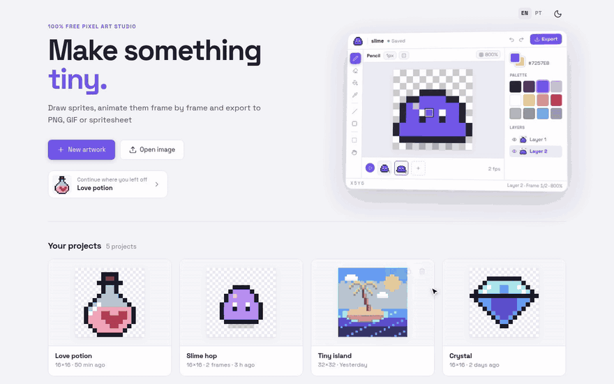
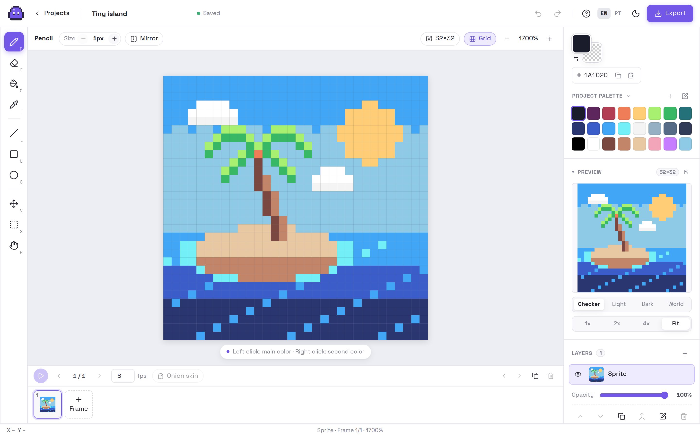
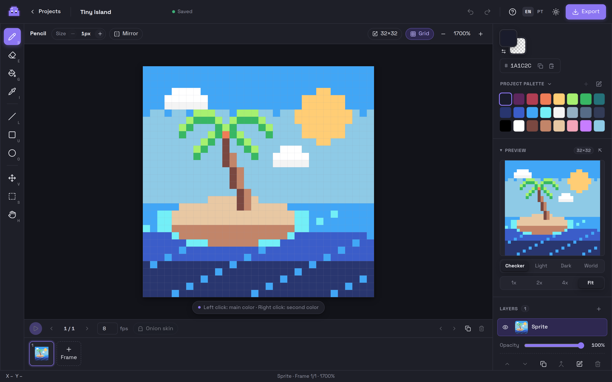

#  Pixelistas

A calm, modern pixel art studio in the browser. Draw sprites with layers and frames, build palettes, and export to PNG, sprite sheet or GIF.



## Features

- **Drawing tools**: pencil, eraser, fill, line, rectangle, ellipse, color picker, with mirror mode and single-key shortcuts
- **Selections**: rectangle and lasso, with add, subtract and intersect, plus move, rotate, copy and paste
- **Layers and frames**: up to 64 frames, onion skin and a live preview panel with adjustable FPS
- **Palette manager**: presets, import from `.gpl`, `.pal`, `.hex`, `.ase`, `.aco` and more, or extract colors from an image
- **Reference image**: place, crop and fade an image above or below the canvas
- **Export**: PNG, sprite sheet or animated GIF, at any scale
- **Local first**: projects and palettes are saved in the browser (IndexedDB), with palette backups
- **Bilingual**: English and Portuguese, plus light and dark themes

| Light | Dark |
| --- | --- |
|  |  |

## Tech stack

- [React 19](https://react.dev) + React Router
- TypeScript
- [Vite](https://vite.dev)
- Lucide icons, Space Grotesk font

## Getting started

```bash
npm install
npm run dev
```

No backend or environment variables needed.

| Command             | Description                        |
| ------------------- | ---------------------------------- |
| `npm run dev`       | Start the dev server               |
| `npm run build`     | Build the static site into `dist/` |
| `npm run preview`   | Preview the production build       |
| `npm run typecheck` | Run the TypeScript checks          |

## Project structure

```
src/
├── main.tsx            App entry
└── studio/
    ├── i18n/           English and Portuguese strings
    ├── Editor.tsx      Editor screen and canvas
    ├── palette*.ts     Palette formats, extraction and quantizing
    ├── exporter.ts     PNG, sprite sheet and GIF export
    ├── storage.ts      IndexedDB persistence
    └── ...             Tools, selection, dialogs, panels
```
